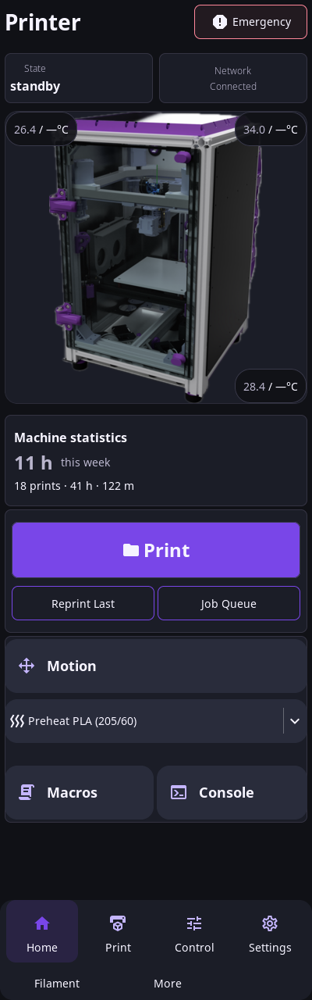
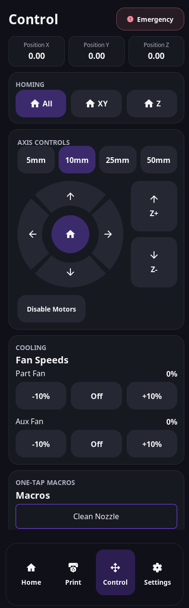

# HelixScreen K3

A customizable native Klipper touchscreen for a Linux host driving a Waveshare
display. Built on [HelixScreen](https://github.com/prestonbrown/helixscreen), with
a dark violet theme inspired by the supplied reference and full-width, scrollable
portrait controls. Landscape screens keep the upstream layout.

**Status:** development fork based on upstream `1.2.0-beta.1`
(`f7f68cca25649b731d47b3d2a81b51197d699ed1`). Simulator verification is recorded in
[k3/VALIDATION.md](k3/VALIDATION.md). No physical K3 panel or printer has been tested.
“K3” is not a verified Waveshare SKU; no resolution, display overlay, touch driver,
or printer hardware is guessed. Start with automatic display detection.

## What you get

- Native LVGL interface talking directly to Moonraker; no browser kiosk needed.
- Home widgets, printer image, temperatures, print files, job control and history.
- Homing, XY/Z motion, extrusion, cooling, macros and console.
- Bed mesh, Z offset, input shaper, PID and other upstream calibration tools.
- Upstream filament systems, multi-printer support, Spoolman, cameras and lights
  when supported/configured by your printer. Optional features remain capability dependent.
- Theme editor, light/dark modes, rearrangeable home widgets and custom images.
- K3 profile CLI with backups, restore, custom accent, display size/rotation,
  touch-device selection, brightness and appearance-only export/import.

This is a downstream customization of HelixScreen, not a new firmware for an
MCU-only screen. It requires a Linux host such as a Raspberry Pi with a working
display and touch input, plus Klipper and Moonraker on that host or on the network.

## Native screenshots

400x1280 captures with synthetic printer data. The printer picture is the
upstream Voron demo asset; use Printer Manager to select your own K3 image.

 

[Motion](docs/images/k3/motion.png) · [Settings](docs/images/k3/settings.png) ·
[Scrolled compact controls](docs/images/k3/compact-controls-scrolled.png) ·
[Emergency confirmation](docs/images/k3/emergency-confirmation.png)

## Start here

For hardware setup, installation, customization and rollback, see
[the K3 guide](k3/README.md). The original upstream guide is in
[README.md](README.md).

```bash
git clone --recurse-submodules https://github.com/alextverdyy/helixscreen-k3.git
cd helixscreen-k3
python3 k3/configure.py profiles
python3 k3/configure.py doctor
```

The configuration tool requires Python 3.9+ and uses only its standard library.
`doctor` inventories local display/input devices without connecting to a printer.

## Preview on a Linux development machine

Follow [upstream build prerequisites](docs/devel/ONBOARDING.md), then:

```bash
make
python3 k3/demo.py --size 480x800
# No display server required for captures:
python3 k3/demo.py --size 400x1280 --capture /tmp/k3-screenshots
python3 -m unittest discover -s k3 -p 'test_*.py' -v
```

The demo always uses `--test`, a temporary config and a private control socket.
It cannot be switched to a real printer through its arguments.

## Build for the display host

Use the upstream cross-build rather than deploying the desktop simulator:

```bash
# On a Linux development machine with Docker installed:
make pi-docker        # Raspberry Pi, 64-bit, DRM
make pi-fbdev-docker  # Optional framebuffer fallback
```

See [the upstream build system](docs/devel/BUILD_SYSTEM.md) for deployment,
packaging, other architectures and required runtime libraries. The manual
**K3 Pi build** GitHub workflow compiles the 64-bit DRM/framebuffer binaries and
packages an installer archive as a build artifact. A successful cross-build does
not validate a physical panel.

After a successful build, **K3 reviewed installer** checks that application
sources are unchanged, refreshes the reviewed runtime files and setup tools, and
creates a draft preview release with checksums and build provenance. Its
`k3-reviewed-pi-installer` artifact is the complete K3 delivery. Draft releases
are available to the repository owner; nothing is declared hardware-validated.

## Keeping updates predictable

The theme is installed in the user configuration directory so normal upstream
updates preserve it. The custom portrait XML belongs to this fork; installing an
upstream package over it replaces that layout. Reapply the fork's matching
layout only with a binary built from the same source revision. Do not copy this
development XML into an older stable release.

Applying the K3 profile disables upstream in-screen updates, which would replace
the fork's layout. Update through this fork's packages deliberately. Restore the
pre-K3 configuration to restore the previous update policy. The upstream project
provides the printer functionality and remains credited throughout this tree.

GPL-3.0; see [LICENSE](LICENSE) and [COPYRIGHT](COPYRIGHT).
